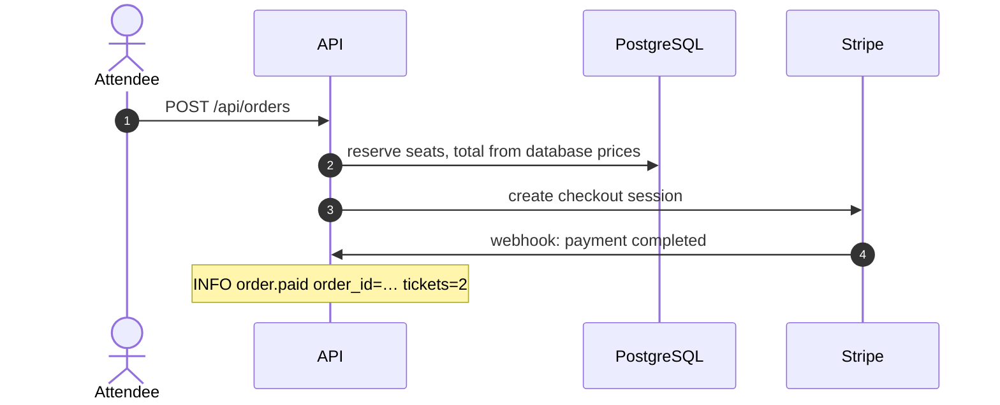

# Threat model: TicketCon checkout

| | |
|---|---|
| **Mode** | design |
| **Date** | 2026-11-02 |
| **Source** | `docs/checkout-design.md` v3 |
| **Stage** | complete |
| **Counts** | 2 stories · 5 groups (2 door, 1 window, 2 hole) · 4 threats · 4 mitigations · 6 tests |

## Summary

Two sentences on what the system does and where most of the risk sits.

| Status | Threats |
|---|---|
| ❌ Missing | T3 |
| ⚠️ Partially mitigated | — |
| ❓ Needs verification | T1, T2, T4 |

## 1. Stories

**What:** attendees buy tickets for events through Stripe Checkout.

**How:**

### S1: Attendee buys a ticket

A signed-in attendee orders two tickets and pays on Stripe; the webhook marks the order paid.

## 2. General scope

- **Users and roles:** anonymous visitors, signed-in attendees, Stripe (webhook). One organization.
- **Data:** attendee names and emails (PII); payment status. Card data stays on Stripe.
- **Other assets:** ticket revenue, seat capacity.
- **Links:** `docs/checkout-design.md`

| Question | Answer |
|---|---|
| Roles, and several organizations? | ⛔ One organization: owner checks are object-level authorization |
| Sensitive data? | ✅ Attendee PII: exposing attendee data is High |

## 3. Doors, windows and holes

### Questions

**🚪 Doors** · Backend routes: `POST /api/orders`, `GET /api/orders/:id`

| Question | Answer |
|---|---|
| New or changed backend routes? | ✅ Added D1 |
| Only known callers? | ✅ T1 |
| Resource ID? | ✅ T2 |
| Mutating, with session cookies? | ⛔ Bearer token in a header, no cookies |
| Webhooks from a third party? | ✅ Added D2 (covered in the full model) |
| Redirect to a location from the URL? | ➖ Not in scope: the design shows no redirects |

**🪟 Windows** · Queues: SQS `order-paid`

| Question | Answer |
|---|---|
| Anyone besides the producer can send? | ✅ Added W1, T3 |

**🕳️ Holes** · Data stores: PostgreSQL through the order store

| Question | Answer |
|---|---|
| User input in SQL? | ✅ Added H1, T4 |
| User input in NoSQL? | ⛔ PostgreSQL only |

### 🚪 D1: Order routes (signed-in attendee)

- **Members:** `POST /api/orders`, `GET /api/orders/:id`
- **Grouped because:** same auth middleware, same owner-scoping helper
- **Who can reach it:** any signed-in user · **Authentication:** bearer token
- **Input:** `eventId`, `items[{ticketTypeId, qty}]`, `attendees[{name, email}]`
- **Stories:** S1 · step 1
- **Ruled out:** CSRF (bearer token in a header, no cookies)

### 🪟 W1: SQS `order-paid`

- **Members:** `order-paid`, `order-paid-dlq`
- **What makes it an entry point:** anyone with `sqs:SendMessage` creates tickets the worker trusts

### 🕳️ H1: SQL in the order store

- **Members:** `orderStore.create`, `orderStore.get`, `ticketTypeStore.reserve`
- **Grouped because:** same query builder, values bound
- **Sink type:** SQL · **Input that reaches it:** `eventId`, `ticketTypeId`, `qty`

## 4. Threats

Grouped by door, window and hole: doors, then windows, then holes, so
business logic comes before source to sink.

### 🚪 D1: Order routes

| | Threat (What) | Who | Impact | Category | Mitigations | Status | Severity |
|---|---|---|---|---|---|---|---|
| T1 | Missing AuthN: calls the API with no valid bearer token (also at D2) | Unauthenticated user | Orders on other users' accounts | 🔓 Business logic | M1 | ❓ | High |
| T2 | IDOR: changes the order ID in `GET /api/orders/:id` | Any signed-in attendee | Reads other attendees' names, emails and amounts | 🔓 Business logic | M2 | ❓ | High |

Library: T1 [Broken authentication](https://mohamed-osama-aboelkheir.github.io/appsec-untangled-resources/threats/business-logic/broken-authentication/) · T2 [Broken object-level authorization](https://mohamed-osama-aboelkheir.github.io/appsec-untangled-resources/threats/business-logic/broken-object-level-authorization/)

### 🪟 W1: SQS `order-paid`

| | Threat (What) | Who | Impact | Category | Mitigations | Status | Severity |
|---|---|---|---|---|---|---|---|
| T3 | Forged "order paid" message | Any AWS principal with `sqs:SendMessage` | Real tickets issued without payment | 🔓 Business logic | M3 | ❌ | High |

Library: T3 [Windows: queues, topics and event buses](https://mohamed-osama-aboelkheir.github.io/appsec-untangled-resources/threat-modeling/windows/#queues-topics-and-event-buses)

### 🕳️ H1: SQL in the order store

| | Threat (What) | Who | Impact | Category | Mitigations | Status | Severity |
|---|---|---|---|---|---|---|---|
| T4 | SQL injection through order input (source: D1 `items[].ticketTypeId` → `ticketTypeStore.reserve`) | Any signed-in attendee | Reads or changes the whole database | 💉 Source to sink | M4 | ❓ | Critical |

Library: T4 [SQL injection](https://mohamed-osama-aboelkheir.github.io/appsec-untangled-resources/threats/source-to-sink/sql-injection/)

## 5. Mitigations

| | Mitigation (what must be true) | Kind | Threats | Status | Evidence |
|---|---|---|---|---|---|
| M1 | Verify the JWT (signature, issuer, audience, expiry); take the user ID from the token | Access control check | T1 | ❓ Needs verification | Assumption |
| M2 | Load the order scoped to `user_id = caller`; same 404 for missing and not yours | Access control check | T2 | ❓ Needs verification | Assumption |
| M3 | Queue policy allows only the API task role; the worker re-checks `orders.status = 'paid'` | Platform / cloud config | T3 | ❌ Missing | design §4 shows no queue policy |
| M4 | Parameterized queries only, no raw fragments | Safe function | T4 | ❓ Needs verification | Assumption |

## 6. Testing plan

| | Test | Mitigations | Type | Kind | How | Where it runs |
|---|---|---|---|---|---|---|
| Q1 | Order routes reject missing and bad tokens | M1 | 🔁 Continuous | Integration test | No token, expired token, wrong audience: expect 401 | API integration suite in CI |
| Q2 | Two-user order access | M2 | ⏱️ Point-in-time | Dynamic test (Burp) | User B requests user A's order; expect 404 | Before release, AppSec |
| Q3 | Two-user order access stays denied | M2 | 🔁 Continuous | Integration test | Same as Q2 | API integration suite in CI |
| Q4 | Queue policy denies other roles | M3 | ⏱️ Point-in-time | Config review | `SendMessage` as another role is denied | Before release |
| Q5 | Queue policy in IaC | M3 | 🔁 Continuous | Policy-as-code / IaC check | Fails if the policy allows more than the API role | IaC pipeline |
| Q6 | No string-built SQL | M4 | 🔁 Continuous | SAST rule | Fails the build on raw or concatenated SQL | Semgrep in CI |

## 7. Assumptions and open questions

**Assumptions**

- The worker trusts the queue message and does not re-read the order.

**Open questions**

1. Does the worker read the database, or trust the message only? (Decides T3.)
