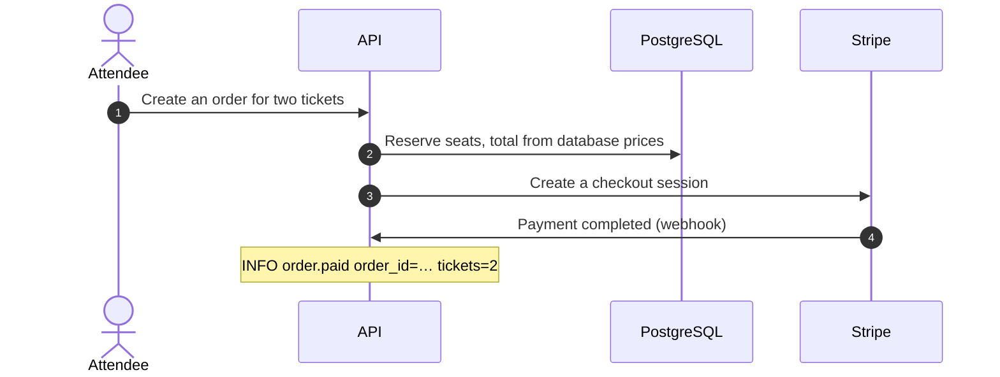

# Threat model: TicketCon checkout

| | |
|---|---|
| **Mode** | design |
| **Date** | 2026-11-02 |
| **Source** | `docs/checkout-design.md` v3 |
| **Counts** | 2 stories · 7 groups (3 door, 2 window, 2 hole) covering 11 members · 9 threats · 8 tests |

## Summary

Two sentences on what the system does and where most of the risk sits.

| Status | Threats |
|---|---|
| ❌ Missing | T4 |
| ⚠️ Partially mitigated | — |
| ❓ Needs verification | T1, T2, T3, T5, T6, T7, T8, T9 |

## 1. Stories

### S1: Attendee buys a ticket

## 2. Scope

- **Goal:** attendees buy tickets through Stripe Checkout.
- **Users and roles:** anonymous visitors, signed-in attendees, Stripe (webhook).
- **In scope:** `POST /api/orders`, `GET /api/orders/:id`, `POST /api/webhooks/stripe`, SQS `order-paid`.
- **Data and credentials:** attendee names and emails; Stripe secret key, webhook secret.
- **Assumptions:** the API uses a bearer token in the `Authorization` header, not cookies.

## 3. Doors, windows and holes

### 🚪 D1: Order routes (signed-in attendee)

- **Members:** `POST /api/orders`, `GET /api/orders/:id`
- **Grouped because:** same auth middleware, same owner scoping helper
- **Who can reach it:** any signed-in user · **Authentication:** bearer token
- **Input:** `eventId`, `items[{ticketTypeId, qty}]`, `attendees[{name, email}]`
- **Stories:** S1 · step 1
- **Ruled out:** CSRF (bearer token in a header, no cookies)

### 🪟 W1: SQS `order-paid`

- **Members:** `order-paid`, `order-paid-dlq`
- **What makes it an entry point:** anyone with `sqs:SendMessage` creates tickets the worker trusts

### 🕳️ H1: SQL in the order store

- **Members:** `orderStore.create`, `orderStore.get`, `ticketTypeStore.reserve`
- **Grouped because:** all built with the same query builder, values bound
- **Sink type:** SQL · **Input that reaches it:** `eventId`, `ticketTypeId`, `qty`

## 4. Threats and mitigations

### 🚪 D1: Order routes

#### T1 · Read another attendee's order

- **Who:** any signed-in attendee
- **What:** changes the order ID in `GET /api/orders/:id`
- **Impact:** reads other attendees' names, emails and amounts
- **Mitigation:** load the order scoped to `user_id = caller`; same 404 for missing and not yours
- **Kind:** Access control check · **Library:** [Broken object-level authorization](https://mohamed-osama-aboelkheir.github.io/appsec-untangled-resources/threats/business-logic/broken-object-level-authorization/)
- **Status:** ❓ Needs verification · **Severity:** High · **Evidence:** Assumption

### 🪟 W1: SQS `order-paid`

#### T4 · Forged "order paid" message

- **Who:** any AWS principal with `sqs:SendMessage` on the queue
- **What:** sends an `OrderPaid` message for an unpaid order
- **Impact:** real tickets issued without payment
- **Mitigation:** queue policy allows only the API task role; the worker re-checks `orders.status = 'paid'`
- **Kind:** Platform / cloud config · **Library:** [Windows: queues, topics and event buses](https://mohamed-osama-aboelkheir.github.io/appsec-untangled-resources/threat-modeling/windows/#queues-topics-and-event-buses)
- **Status:** ❌ Missing · **Severity:** High · **Evidence:** design §4 shows no queue policy

### 🕳️ H1: SQL in the order store

#### T7 · SQL injection through order input

- **Who:** any signed-in attendee
- **What:** input changes the structure of a query
- **Source → sink:** D1 `items[].ticketTypeId` → `ticketTypeStore.reserve`
- **Mitigation:** parameterized queries only, no raw fragments
- **Kind:** Safe function · **Library:** [SQL injection](https://mohamed-osama-aboelkheir.github.io/appsec-untangled-resources/threats/source-to-sink/sql-injection/)
- **Status:** ❓ Needs verification · **Severity:** Critical · **Evidence:** Assumption

## 5. Testing plan

| Test | Threats | When | Type | How | Where it runs |
|---|---|---|---|---|---|
| Q1 · Two-user order access | T1 | Point-in-time, continuous | Integration test | User B requests user A's order; expect 404 | API integration suite in CI |
| Q4 · Queue policy denies other roles | T4 | Point-in-time, continuous | Policy-as-code / IaC check | `SendMessage` as another role is denied | IaC pipeline |
| Q7 · No string-built SQL | T7 | Continuous | SAST rule | Fails the build on raw or concatenated SQL | Semgrep in CI |

## 6. Assumptions and open questions

**Assumptions**

- The worker trusts the queue message and does not re-read the order.

**Open questions**

1. Does the worker read the database, or trust the message only? (Decides T4.)
